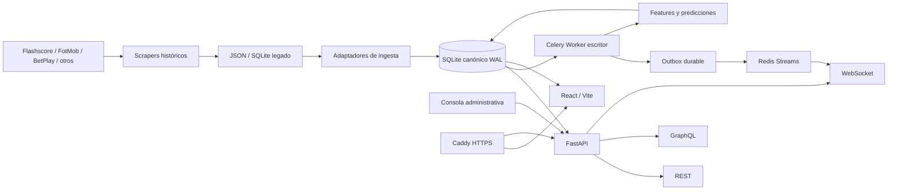
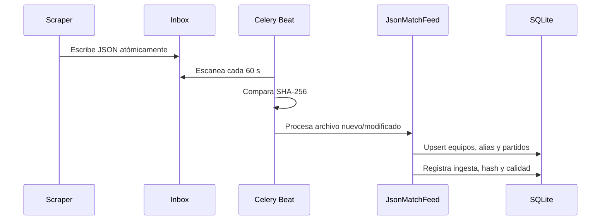
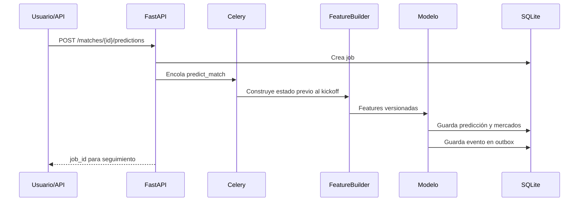

# FAIS — Contexto completo del sistema

**Documento de referencia funcional y técnica**  
**Fecha de actualización:** 19 de octubre de 2026  
**Repositorio:** `fsimancas/analisis`  
**Plataforma principal:** `platform/`  
**Demo autónoma:** `FAIS_demo.html`

---

## 1. Resumen ejecutivo

FAIS es una plataforma de inteligencia deportiva orientada inicialmente al fútbol. Su objetivo es reunir datos procedentes de distintas fuentes, normalizarlos, detectar problemas de calidad, producir análisis probabilísticos reproducibles y presentarlos mediante una interfaz web similar a una terminal de mercados deportivos.

El repositorio contiene dos generaciones de software:

1. **Sistema histórico de extracción y análisis:** scrapers, archivos JSON, bases SQLite y herramientas de consola situadas en la raíz del repositorio.
2. **Plataforma FAIS:** aplicación modular dentro de `platform/`, con FastAPI, SQLite, Redis, Celery, React, GraphQL, WebSocket, modelos analíticos, administración, auditoría y despliegue nativo.

También existe `FAIS_demo.html`, una maqueta HTML5 completamente autónoma. Su función es mostrar la experiencia de producto deseada en equipos con pocos recursos. No utiliza servidor, no modifica la base de datos y emplea datos simulados.

La arquitectura está diseñada para ser ligera:

- no usa contenedores;
- no usa PostgreSQL;
- SQLite es la fuente de datos operacional;
- Redis se utiliza para colas, eventos y protecciones administrativas;
- Celery ejecuta trabajos asíncronos;
- React/Vite genera un frontend estático;
- Caddy publica la web y termina HTTPS;
- systemd administra los procesos en producción.

---

## 2. Objetivo del producto

El producto final busca combinar tres experiencias:

- **Flashscore:** navegación por países, competiciones, jornadas, partidos en vivo, equipos y resultados.
- **TradingView/MetaTrader:** paneles densos de información, señales, probabilidades, tendencias, comparación y actualización en tiempo real.
- **Laboratorio analítico:** trazabilidad de datos, backtests, versiones de modelos, calibración y promoción controlada de modelos.

El sistema debe permitir:

- consultar países, competiciones, equipos y partidos;
- identificar partidos en vivo y próximos encuentros;
- consultar estadísticas históricas y tendencias;
- generar probabilidades prepartido sin fuga de información futura;
- derivar mercados como 1X2, goles y ambos marcan;
- administrar datos, usuarios, fuentes, alertas y modelos;
- ejecutar importaciones, backtests y entrenamientos;
- recibir eventos mediante WebSocket;
- conservar auditoría y procedencia de cada dato;
- evolucionar hacia jugadores, árbitros, alineaciones, eventos, cuotas y análisis táctico detallado.

FAIS no debe presentar una probabilidad como garantía de resultado ni ejecutar apuestas automáticamente.

---

## 3. Estado real del sistema

La siguiente clasificación evita confundir código operativo con prototipos visuales.

| Estado | Significado |
|---|---|
| **Operativo** | Existe código conectado a la base/API y tiene pruebas. |
| **Condicionado** | Existe, pero necesita Redis, credenciales, dominio, datos o configuración externa. |
| **Demo** | Se puede interactuar visualmente, pero usa datos simulados y no persiste. |
| **Pendiente** | Forma parte de la visión, pero todavía requiere modelo de datos, API o implementación. |

### 3.1 Funcionalidades operativas

- base canónica SQLite con 11 migraciones;
- importación idempotente desde SQLite legado;
- ingesta incremental desde feeds JSON;
- bandeja de entrada de archivos con detección SHA-256;
- países, competiciones, equipos, alias, temporadas y partidos;
- precisión temporal y fechas ambiguas conservadas sin inventar horas;
- registro de problemas de calidad;
- API REST, GraphQL y WebSocket;
- exploradores web de partidos y equipos;
- modelo Poisson regularizado;
- predicciones 1X2, totales y ambos marcan;
- backtesting cronológico walk-forward;
- registro de modelos y challenger XGBoost opcional;
- usuarios, roles, JWT, favoritos, alertas y notificaciones;
- administración web con CRUD y auditoría;
- cargas JSON y SQLite desde el navegador;
- ejecución web de ingestas, backtests y entrenamiento;
- aprobación o rechazo administrativo de modelos;
- health, readiness, métricas y backups verificados;
- despliegue nativo mediante Caddy y systemd.

### 3.2 Funcionalidades condicionadas

- Celery, eventos, WebSocket y rate limiting distribuido necesitan Redis activo;
- webhooks necesitan URL HTTPS, token y lista permitida de destinos;
- publicación pública necesita servidor Linux, dominio, DNS y TLS;
- XGBoost necesita instalar el extra opcional `ml`;
- PyTorch está preparado como extensión, pero no forma parte del runtime normal;
- la información realmente “en vivo” depende de que los scrapers o proveedores alimenten el inbox y emitan eventos.

### 3.3 Funcionalidades presentes en la demo HTML, pero no conectadas todavía

`FAIS_demo.html` muestra de manera interactiva:

- árbol de países y competiciones tipo Flashscore;
- ficha general de competición;
- clasificación y mercados de tendencia;
- perfiles avanzados de equipos;
- perfiles individuales de jugadores;
- perfiles y tendencias de árbitros;
- estadísticas local contra visitante;
- formaciones sobre un campo;
- formulario para agregar la alineación final;
- análisis con un clic;
- simulaciones Monte Carlo ilustrativas;
- cuotas organizadas por mercados.

Estos datos son simulados. El HTML no llama a FastAPI, no lee SQLite y no guarda cambios.

### 3.4 Funcionalidades pendientes de integración real

- tablas canónicas de jugadores y árbitros;
- plantillas, transferencias y perfiles históricos de jugadores;
- alineaciones probables y confirmadas persistidas;
- sistemas tácticos y posiciones sobre el campo;
- estadísticas individuales por partido;
- eventos minuto a minuto;
- estadísticas completas del partido, como tiros, posesión, tarjetas y córners;
- API pública para `odds_snapshots` y comparación de casas;
- historial de movimientos de cuotas;
- tendencias de mercado por competición calculadas en backend;
- simulador Monte Carlo conectado a datos reales;
- análisis narrativo mediante LLM;
- vistas React equivalentes a toda la experiencia de `FAIS_demo.html`;
- proveedor en vivo con contrato y frecuencia de actualización garantizados;
- ClickHouse para millones de eventos o ticks.

---

## 4. Arquitectura general



### 4.1 Principios arquitectónicos

1. **SQLite es la fuente operacional.**
2. **Un solo worker serializa las escrituras intensivas.**
3. **Los scrapers no forman parte del proceso web.** Producen archivos o datos que luego ingiere la plataforma.
4. **REST ejecuta comandos y lecturas simples.**
5. **GraphQL compone lecturas.**
6. **WebSocket distribuye eventos, no almacena estado del negocio.**
7. **El outbox SQLite evita perder eventos si Redis está caído.**
8. **Las predicciones se versionan y conservan su cutoff temporal.**
9. **El frontend representa resultados; no debe recalcular probabilidades.**
10. **Los componentes opcionales solo se incorporan cuando el volumen lo justifica.**

---

## 5. Organización del repositorio

```text
analisis/
├── FAIS_demo.html                 # Demo HTML5 autónoma
├── CONTEXTO_COMPLETO_FAIS.md      # Este documento
├── *.py                           # Scrapers y utilidades históricas
├── *.json / *.md                  # Capturas, mapeos e informes históricos
├── *.db                           # Bases SQLite de origen
└── platform/
    ├── backend/                   # FastAPI, dominio, ingesta, IA y workers
    ├── web/                       # React + Vite + TypeScript
    ├── deploy/                    # Caddy, Redis y unidades systemd
    ├── docs/                      # Arquitectura y operaciones
    ├── scripts/                   # Verificación, backup, importación y preflight
    ├── data/                      # Base canónica local y runtime ignorado
    └── Makefile                   # Comandos frecuentes
```

---

## 6. Sistema histórico de adquisición de datos

Los scripts de la raíz son la capa original de extracción. No todos tienen el mismo contrato ni el mismo nivel de mantenimiento. La plataforma nueva no ejecuta Selenium dentro de FastAPI; consume las salidas de estos procesos.

### 6.1 Scrapers principales

| Archivo | Responsabilidad |
|---|---|
| `scraper_flashscore.py` | Extrae países y competiciones de Flashscore y construye mapeos. |
| `scraper_todas_las_competiciones.py` | Recorre competiciones, partidos históricos/próximos, checkpoints y sincronización JSON/SQLite. |
| `scraper_hoy_flashscore.py` | Extrae partidos del día, resultados o estados en vivo. |
| `scraper_manana.py` | Ejecuta la descarga de próximos partidos. |
| `scraper_partidos.py` | Parsea HTML de partidos y guarda resultados/próximos. |
| `scraper_detalles_partidos.py` | Extrae resumen, estadísticas, alineaciones y detalles de un partido. |
| `scraper_detalles_partidos_optimizado.py` | Variante optimizada con reanudación y checkpoints. |
| `scraper_fotmob_betplay.py` | Obtiene datos de FotMob y los relaciona con competiciones BetPlay. |
| `scraper_betplay.py` | Consulta eventos y mercados BetPlay, y los almacena. |
| `scraper_betplay_cuotas.py` | Descarga cuotas y clasifica mercados. |

### 6.2 Orquestación histórica

`menu.py` ofrece un menú de consola para:

- descargar pendientes;
- hacer actualizaciones incrementales;
- filtrar por país o competición;
- consultar checkpoints;
- reintentar errores;
- descargar cuotas;
- ejecutar el flujo diario;
- obtener detalles y boxscores;
- combinar FotMob y Flashscore.

`ejecutar_descarga_hibrida.py` coordina pipelines de FotMob y Flashscore.

### 6.3 Parsing y análisis histórico

- `parsers_detalle.py`: resumen, estadísticas, alineaciones y tablas de jugadores.
- `estadisticas_liga.py`: estadísticas agregadas por liga.
- `analizador_betplay.py`: priorización y análisis de mercados.
- `generar_db_y_json.py`: construcción de artefactos JSON y SQLite desde documentación/mapeos.
- scripts `build_*`, `fix_*`, `verify_*` y `repair_urls.py`: construcción, reparación y validación de mapeos.

### 6.4 Relación con la plataforma

El flujo recomendado es:

```text
Scraper externo
  -> escribe JSON de forma atómica
  -> FAIS_INBOX_PATH/país/competición/archivo.json
  -> InboxScanner calcula SHA-256
  -> JsonMatchFeed normaliza y actualiza SQLite
```

Los scripts históricos no deben escribir directamente en las tablas canónicas sin pasar por un adaptador.

---

## 7. Modelo de datos canónico

SQLite se configura con:

- `foreign_keys=ON`;
- modo WAL;
- `busy_timeout=10000`;
- `synchronous=NORMAL`;
- transacciones de escritura `BEGIN IMMEDIATE`;
- conexiones de lectura en modo `mode=ro`.

Las migraciones se aplican en orden y se registran en `schema_migrations`.

### 7.1 Catálogo deportivo

| Tabla | Propósito |
|---|---|
| `source_providers` | Fuentes externas conocidas. |
| `countries` | Países y metadatos originales. |
| `competitions` | Competiciones, deporte, género, nivel y estado. |
| `competition_provider_refs` | Identificadores y URL de una competición por proveedor. |
| `seasons` | Temporadas con rango temporal, método y confianza de asignación. |
| `teams` | Identidad canónica de equipos por país. |
| `team_provider_refs` | Identificadores de equipo por proveedor. |
| `team_aliases` | Variaciones de nombre contextualizadas por fuente y país. |
| `matches` | Partido canónico, fecha, precisión, estado, marcador y tipo. |
| `match_provider_refs` | Referencia externa, URL, hash y fecha de captura. |
| `odds_snapshots` | Instantáneas de cuotas por partido, mercado y selección. |

### 7.2 Ingesta y calidad

| Tabla | Propósito |
|---|---|
| `ingestion_runs` | Historial de ejecuciones de ingesta. |
| `feed_files` | Estado y hash de cada archivo del inbox. |
| `data_quality_issues` | Alertas de calidad, severidad, contexto y resolución. |

### 7.3 Analítica y modelos

| Tabla | Propósito |
|---|---|
| `feature_snapshots` | Features de un equipo en un cutoff determinado. |
| `predictions` | Probabilidades, mercados, modelo, features e input hash. |
| `model_versions` | Registro de modelos, artefactos, métricas y estado activo. |
| `backtest_runs` | Resultados de evaluaciones cronológicas. |
| `model_reviews` | Aprobaciones o rechazos administrativos de modelos. |

### 7.4 Procesamiento y eventos

| Tabla | Propósito |
|---|---|
| `jobs` | Estado de trabajos asíncronos. |
| `event_outbox` | Eventos comprometidos en SQLite y pendientes de Redis. |

### 7.5 Identidad y personalización

| Tabla | Propósito |
|---|---|
| `users` | Cuenta, contraseña Argon2, rol y activación. |
| `favorites` | Equipos o partidos seguidos por usuario. |
| `alerts` | Alertas configuradas para un partido. |
| `notifications` | Notificaciones generadas de forma idempotente. |
| `notification_deliveries` | Entrega webhook, intentos y reintentos. |

### 7.6 Administración

| Tabla | Propósito |
|---|---|
| `audit_log` | Actor, acción, entidad, antes/después, IP y fecha. |
| `alert_channels` | Canales configurables de alertas. |
| `scraper_sources` | Países/competiciones permitidos para escaneo del inbox. |
| `admin_uploads` | Archivos cargados, hash, tamaño, job y resultado. |

### 7.7 Tratamiento temporal

Un partido puede tener:

- `kickoff_utc`: fecha y hora exactas;
- `kickoff_date`: fecha local sin hora;
- `kickoff_raw`: valor original sin alterar;
- `kickoff_timezone`: zona horaria asumida o conocida;
- `kickoff_precision`: exacta, solo fecha, ambigua o desconocida;
- `kickoff_year_inferred`: indica si el año fue inferido.

El sistema nunca inventa una hora para una fecha que solo contiene día. Los casos ambiguos se registran como problemas de calidad.

---

## 8. Módulos del backend

### 8.1 Configuración — `fais.config`

Lee variables `FAIS_*` y valida el arranque. Controla:

- ruta de SQLite;
- URL de Redis;
- CORS;
- hosts confiables;
- secreto JWT;
- duración de tokens;
- ambiente;
- inbox;
- dominio público;
- webhook y destinos permitidos.

En producción exige HTTPS, dominio público, secreto de al menos 32 caracteres y hosts explícitos.

### 8.2 Base de datos — `fais.db`

- `connection.py`: conexiones y transacciones seguras.
- `migrate.py`: aplicación atómica de migraciones SQL.
- `repositories.py`: consultas de overview, competiciones, partidos, equipos, calidad, modelos y backtests.

### 8.3 Dominio — `fais.domain`

Define conceptos invariantes como:

- estados de partido;
- tipo resultado/próximo;
- severidades de calidad;
- marcador sin goles negativos.

### 8.4 Ingesta — `fais.ingestion`

#### `LegacyImporter`

Importa el SQLite histórico. Es idempotente porque relaciona cada registro con su proveedor e identificador externo. Normaliza países, competiciones, equipos, alias y partidos.

#### `JsonMatchFeed`

Consume un array JSON producido por los scrapers. Valida campos mínimos, crea o actualiza equipos, conserva hash del registro y actualiza el partido.

#### `InboxScanner`

Recorre `país/competición/*.json`, calcula SHA-256 y solo procesa archivos nuevos o modificados. Las fuentes administrativas pueden limitar qué carpetas están habilitadas.

#### `temporal.py`

Interpreta fechas con una política conservadora y usa `America/Bogota` como zona de origen predeterminada para los feeds actuales.

#### `seasons.py`

Asigna temporadas según rangos observados y conserva método/confianza.

### 8.5 Analítica — `fais.analytics`

#### Features temporales

`FeatureBuilder` reconstruye el estado disponible antes del kickoff objetivo. Entre las señales se encuentran forma, goles a favor/contra, fuerza local/visitante y antecedentes disponibles.

La regla principal es:

```text
feature_cutoff < kickoff_del_partido_objetivo
```

No se usan datos finales del mismo partido.

#### Poisson regularizado

`RegularizedPoisson` estima goles esperados local/visitante. A partir de estos valores se genera una matriz de marcadores y se derivan:

- victoria local;
- empate;
- victoria visitante;
- más/menos de 2.5 goles;
- ambos equipos marcan;
- marcadores probables.

#### Motor de predicción

`PredictionEngine`:

1. carga el partido;
2. construye features en el cutoff correcto;
3. elige el modelo activo o baseline;
4. calcula probabilidades;
5. guarda feature/model version;
6. guarda input hash y payload;
7. emite un evento de predicción completada.

#### Backtest

`WalkForwardBacktest` evalúa en orden cronológico. Calcula accuracy, log loss, Brier score y error esperado de calibración.

El baseline documentado fue evaluado sobre 17.038 partidos elegibles:

- accuracy: 48,10 %;
- log loss: 1,0299;
- Brier: 0,6186;
- ECE: 1,98 %.

#### XGBoost

El extra `ml` entrena un modelo CPU multiclase con partición cronológica entrenamiento/validación/prueba. Un challenger solo es promovible si supera los gates definidos frente a Poisson.

#### PyTorch

Existe una red opcional básica como punto de extensión. No se importa en el runtime normal y no existe todavía un pipeline completo de entrenamiento/promoción neuronal.

### 8.6 Jobs — `fais.jobs`

`JobStore` crea y actualiza trabajos con estados como pendiente, iniciado, exitoso o fallido. La API devuelve un `job_id` para supervisión.

`EventOutbox` conserva eventos dentro de la misma transacción que genera el cambio de negocio.

### 8.7 Workers — `fais.workers`

Celery ejecuta:

- importación legado;
- ingesta JSON;
- escaneo de inbox;
- predicción de partido;
- backtest;
- entrenamiento XGBoost;
- publicación del outbox;
- generación y entrega de notificaciones.

Todos se enrutan actualmente a `writer`, con concurrencia 1, para serializar escrituras SQLite.

Celery Beat programa:

- outbox cada 10 segundos;
- inbox cada 60 segundos;
- notificaciones cada 15 segundos.

### 8.8 Eventos y realtime

El recorrido de un evento es:

```text
Transacción SQLite
  -> event_outbox
  -> dispatch_outbox
  -> Redis Stream fais:<topic>
  -> WebSocket /ws/<topic>
  -> navegador
```

Si Redis falla, el evento queda pendiente en SQLite.

### 8.9 Identidad — `fais.auth` y `fais.api.identity`

- contraseñas Argon2id;
- mínimo 10 caracteres para usuarios;
- mínimo 12 caracteres al crear administrador por CLI;
- JWT HS256;
- tokens administrativos limitados a un máximo de 60 minutos;
- roles `USER`, `ANALYST` y `ADMIN`;
- bloqueo mediante `active=0`;
- favoritos y alertas aislados por `user_id`.

El frontend actual conserva el token en `localStorage`. Para una exposición pública de mayor riesgo se recomienda OIDC y cookies `HttpOnly`.

### 8.10 Alertas y notificaciones

Eventos soportados:

- inicio del partido;
- gol;
- final del partido;
- predicción disponible;
- movimiento de cuota.

La generación es idempotente mediante `alert_id + event_key`. La entrega webhook usa hasta ocho intentos con backoff exponencial.

---

## 9. Interfaces de la API

### 9.1 REST público/de usuario

Prefijo: `/api/v1`

#### Sistema

- `GET /health`
- `GET /readiness`
- `GET /metrics` fuera del prefijo API

#### Deporte

- `GET /overview`
- `GET /competitions`
- `GET /matches`
- `GET /matches/{id}`
- `GET /teams`
- `GET /teams/{id}`

#### Analítica

- `GET /matches/{id}/prediction`
- `POST /matches/{id}/predictions`
- `GET /models`
- `GET /backtests`

#### Calidad y jobs

- `GET /quality/issues`
- `GET /jobs/{job_id}`

#### Identidad

- `POST /auth/register`
- `POST /auth/token`
- `GET /auth/me`

#### Personalización

- `GET/POST /favorites`
- `DELETE /favorites/{id}`
- `GET/POST /alerts`
- `DELETE /alerts/{id}`
- `GET /notifications`
- `POST /notifications/{id}/read`

### 9.2 REST administrativo

Prefijo: `/api/v1/admin`. Requiere JWT y rol `ADMIN`.

- resumen operacional;
- CRUD de países;
- CRUD de competiciones;
- CRUD de equipos;
- CRUD de partidos;
- alias de equipos;
- fusión segura de duplicados;
- resolución de incidencias de calidad;
- activación, bloqueo y cambio de rol de usuarios;
- canales webhook;
- fuentes permitidas para scrapers/inbox;
- ejecución de escaneo;
- listado y supervisión de jobs;
- ejecución de backtest;
- entrenamiento XGBoost;
- carga JSON;
- carga SQLite;
- revisión de modelos;
- historial de auditoría;
- preflight de despliegue.

Las eliminaciones requieren la cabecera `X-Confirm-Action: delete`.

### 9.3 GraphQL

Ruta: `/graphql`.

Actualmente compone lecturas de:

- overview;
- competiciones;
- partidos.

No reemplaza REST para comandos administrativos.

### 9.4 WebSocket

Ruta: `/ws/{topic}`.

Lee desde `fais:{topic}` en Redis Streams. Si no hay eventos envía heartbeat. Si Redis no está disponible cierra con error recuperable.

---

## 10. Panel administrativo

Ruta web: `/admin`.

### 10.1 Resumen

Presenta conteos de países, competiciones, equipos, partidos, usuarios, jobs, cargas, auditoría e incidencias abiertas.

### 10.2 Catálogo

Permite crear, editar y eliminar:

- países;
- competiciones;
- equipos;
- partidos.

Las relaciones y restricciones SQLite evitan eliminar registros todavía referenciados.

### 10.3 Ingestas

- subida JSON de hasta 25 MiB;
- subida SQLite de hasta 25 MiB;
- validación de extensión, tamaño, integridad y esquema;
- registro SHA-256;
- job asíncrono;
- listado de cargas y errores;
- configuración de fuentes país/competición;
- escaneo manual del inbox.

### 10.4 Calidad

- listado de incidencias;
- resolución con usuario y fecha;
- administración de alias;
- fusión de equipos duplicados;
- auditoría antes/después.

Una fusión se rechaza si los equipos han jugado directamente entre ellos, porque podría producir partidos con el mismo equipo como local y visitante.

### 10.5 Usuarios

- listado de usuarios;
- roles;
- activación y bloqueo;
- protección para no desactivar al último administrador activo.

### 10.6 Alertas y canales

- URL webhook;
- habilitación/deshabilitación;
- validación HTTPS en producción;
- lista de hosts permitidos;
- bloqueo de IP privadas para reducir SSRF.

### 10.7 Modelos

- iniciar backtests;
- iniciar entrenamiento XGBoost;
- visualizar modelos activos/challengers;
- aprobar o rechazar promociones;
- registrar notas y auditoría.

Un modelo aprobado no debe sustituir automáticamente al champion sin cumplir las reglas estadísticas.

### 10.8 Auditoría

Registra:

- actor;
- acción;
- tipo e ID de entidad;
- estado anterior;
- estado posterior;
- dirección remota;
- fecha.

### 10.9 Seguridad administrativa

- rol obligatorio;
- token administrativo máximo de 60 minutos;
- límite de 120 solicitudes por minuto mediante Redis;
- fallo cerrado en producción si la protección Redis no está disponible;
- confirmación explícita para borrado;
- límites de upload;
- validación de webhooks;
- Trusted Host y CORS explícito.

---

## 11. Frontend React conectado

Tecnologías:

- React 19;
- Vite;
- TypeScript;
- Tailwind CSS;
- TanStack Query;
- Apache ECharts;
- React Router;
- Lucide Icons.

### 11.1 Rutas

| Ruta | Función |
|---|---|
| `/` | Dashboard, conteos, cobertura, pipeline y partidos recientes. |
| `/matches` | Explorador y filtros de partidos. |
| `/matches/:id` | Partido, marcador, predicción, favorito y alerta. |
| `/teams` | Búsqueda y catálogo de equipos. |
| `/teams/:id` | Perfil, forma, resultados y métricas del equipo. |
| `/intelligence` | Modelos y backtests walk-forward. |
| `/quality` | Incidencias de calidad. |
| `/account` | Registro, login, favoritos y notificaciones. |
| `/admin` | Consola administrativa. |
| `/demo` | Demo React con datos simulados. |

### 11.2 Actualización de datos

TanStack Query administra caché y solicitudes. `useRealtime` abre WebSocket y muestra si el canal está conectado. La recepción de eventos todavía no invalida todas las consultas de forma específica; esa integración puede ampliarse por topic/tipo de evento.

### 11.3 Límites actuales del frontend conectado

- no tiene todavía navegación jerárquica país → competición equivalente a la demo HTML;
- no tiene ficha avanzada de competición;
- no muestra jugadores, árbitros ni alineaciones reales;
- no expone todos los mercados/cuotas;
- el detalle de partido se concentra en información canónica y predicción disponible.

---

## 12. Demo HTML5 autónoma

Archivo: `FAIS_demo.html`.

Características:

- un solo archivo;
- CSS y JavaScript embebidos;
- aproximadamente 46 KiB;
- sin React, Node, Python o servidor;
- sin peticiones de red;
- funciona con doble clic;
- adaptable a escritorio y móvil.

La demo representa la dirección visual del producto:

1. se selecciona país y competición;
2. se visualizan partidos en vivo y próximos;
3. se abre la ficha de competición;
4. se consulta clasificación y mercados de tendencia;
5. se abre un equipo o partido;
6. el partido compara local/visitante;
7. se recorren estadísticas, alineaciones, análisis, simulaciones y cuotas;
8. jugadores y árbitros abren perfiles individuales.

Todas las cifras son ilustrativas. “50.000 simulaciones” es una representación del resultado esperado de un futuro motor real, no un cálculo ejecutado por el HTML.

---

## 13. Flujos principales

### 13.1 Ingesta desde scraper



### 13.2 Predicción de un partido



### 13.3 Notificación

```text
Evento de partido/predicción
  -> outbox
  -> Redis Stream
  -> reglas de alertas activas
  -> notifications
  -> cuenta web
  -> webhook opcional con reintentos
```

### 13.4 Operación administrativa

```text
Administrador autenticado
  -> validación de rol y rate limit
  -> validación Pydantic
  -> transacción SQLite
  -> cambio de negocio
  -> audit_log antes/después
  -> respuesta o job asíncrono
```

---

## 14. CLI y comandos operativos

El comando principal es `fais`.

| Comando | Función |
|---|---|
| `fais check-config` | Valida configuración. |
| `fais migrate` | Aplica migraciones. |
| `fais import-legacy RUTA` | Importa SQLite histórico. |
| `fais ingest-json ARCHIVO ...` | Ingiere un feed concreto. |
| `fais scan-inbox` | Escanea la bandeja de feeds. |
| `fais bootstrap-admin` | Crea o promueve un administrador. |
| `fais stats` | Muestra conteos canónicos. |
| `fais backtest` | Ejecuta evaluación cronológica. |
| `fais predict-upcoming` | Genera predicciones próximas. |
| `fais train-xgboost` | Entrena y registra un challenger CPU. |

El `Makefile` expone atajos para migrar, importar, predecir, entrenar, probar, compilar y verificar.

---

## 15. Observabilidad, backup y recuperación

### 15.1 Endpoints

- `/api/v1/health`: proceso vivo;
- `/api/v1/readiness`: SQLite, Redis y outbox pendiente;
- `/metrics`: formato Prometheus.

### 15.2 Backup

`backup_sqlite.py` usa la API de backup online de SQLite, ejecuta `integrity_check` y conserva una rotación configurable.

El timer de producción ejecuta backup cada seis horas y conserva por defecto 14 copias.

### 15.3 Restauración

1. detener API y workers;
2. verificar `integrity_check` de la copia;
3. restaurar hacia una ruta nueva;
4. cambiar `FAIS_DATABASE_PATH`;
5. ejecutar smoke test REST/GraphQL;
6. validar conteos;
7. publicar solo después de comprobar integridad.

---

## 16. Despliegue nativo

El instalador `platform/deploy/install-native.sh` prepara un servidor Debian/Ubuntu sin contenedores.

### 16.1 Servicios systemd

| Servicio | Responsabilidad |
|---|---|
| `fais-api` | Uvicorn/FastAPI en `127.0.0.1:8000`. |
| `fais-worker` | Celery writer con concurrencia 1. |
| `fais-beat` | Tareas periódicas. |
| `fais-redis` | Redis nativo local. |
| `fais-caddy` | HTTPS, proxy y archivos React compilados. |
| `fais-backup.timer` | Copia verificada cada seis horas. |

### 16.2 Caddy

Caddy:

- sirve `web/dist`;
- envía `/api`, `/graphql` y `/ws` a FastAPI;
- aplica compresión;
- añade cabeceras de seguridad;
- gestiona certificados cuando DNS y dominio son válidos.

### 16.3 Restricciones de producción

- SQLite debe estar en disco local, nunca NFS;
- `/metrics` no debe publicarse libremente;
- secretos en `/etc/fais/fais.env` con permisos restrictivos;
- usuario de sistema dedicado `fais`;
- firewall y DNS configurados externamente;
- no reutilizar el secreto de desarrollo.

---

## 17. Pruebas y verificación

### 17.1 Backend

Las pruebas cubren:

- migraciones;
- importación legado y JSON;
- temporadas y fechas;
- API y GraphQL;
- jobs y Redis;
- predicción y backtesting;
- XGBoost;
- identidad y aislamiento por usuario;
- administración;
- notificaciones y webhooks;
- backups y despliegue.

### 17.2 Frontend

- ESLint;
- TypeScript durante build;
- build Vite;
- Playwright en escritorio y móvil;
- accesibilidad mediante axe;
- navegación y consola administrativa.

### 17.3 Demo HTML

Se verificaron en navegador automatizado:

- navegación país/competición;
- ficha de partido;
- alineaciones y modal final;
- análisis con un clic;
- simulaciones;
- cuotas;
- perfiles de equipo, jugador y árbitro;
- menú móvil;
- cero violaciones graves o críticas de accesibilidad en las vistas revisadas.

### 17.4 Comando integral

```bash
cd platform
./scripts/verify.sh
```

---

## 18. Evolución recomendada para completar la visión Flashscore + IA

### Fase A — Modelo deportivo detallado

Añadir migraciones para:

- `players`;
- `player_provider_refs`;
- `team_squads`;
- `referees`;
- `lineups` y `lineup_players`;
- `match_events`;
- `team_match_statistics`;
- `player_match_statistics`;
- `formations`;
- `injuries` y `suspensions`.

### Fase B — Proveedores y contratos

- definir contrato JSON por entidad;
- separar datos prepartido, en vivo y postpartido;
- registrar timestamp de disponibilidad;
- conservar payload y hash;
- incorporar rate limits y reintentos por proveedor.

### Fase C — API de competición y partido enriquecido

- país → competiciones;
- competición → temporada, clasificación, jornadas y tendencias;
- partido → estadísticas, eventos, alineaciones, árbitro y cuotas;
- equipo → plantilla, forma y mercados;
- jugador/árbitro → perfil histórico;
- endpoints paginados para cuotas y movimientos.

### Fase D — Analítica ampliada

- simulación Monte Carlo real;
- modelos para goles, tarjetas, córners y jugadores;
- features de árbitro y alineación;
- calibración por liga/mercado;
- intervalos de incertidumbre;
- comparación contra probabilidad implícita sin margen de la casa.

### Fase E — Frontend conectado

- portar la navegación de `FAIS_demo.html` a React;
- rutas de competición, jugador y árbitro;
- centro de partido con tabs;
- campo táctico con SVG/Konva solo si aporta valor;
- actualización selectiva por eventos WebSocket;
- virtualización de listas grandes.

### Fase F — Escala analítica

Mantener SQLite para catálogo y configuración. Incorporar ClickHouse únicamente cuando cuotas/eventos generen millones de filas y las consultas temporales lo justifiquen.

---

## 19. Decisiones que no deben romperse

1. No inventar fechas, horas, estadísticas o alineaciones faltantes.
2. No usar datos posteriores al kickoff como features prepartido.
3. No promover modelos solo por accuracy; evaluar calibración y log loss.
4. No ejecutar scrapers Selenium dentro del proceso API.
5. No compartir SQLite mediante NFS.
6. No permitir múltiples writers concurrentes sin rediseñar persistencia.
7. No permitir que un LLM modifique probabilidades fuente.
8. No activar modelos sin backtest y revisión.
9. No exponer webhooks a destinos arbitrarios en producción.
10. No presentar la demo autónoma como si estuviera conectada a datos reales.

---

## 20. Glosario

| Término | Definición |
|---|---|
| **Canonicalización** | Conversión de distintas fuentes a una identidad y esquema comunes. |
| **Cutoff** | Instante máximo de información permitido para una predicción. |
| **Leakage** | Uso accidental de información futura o posterior al partido. |
| **1X2** | Local, empate o visitante. |
| **xG** | Goles esperados. |
| **Brier score** | Error cuadrático de probabilidades; menor es mejor. |
| **Log loss** | Penaliza predicciones probabilísticas incorrectas y demasiado seguras. |
| **ECE** | Error esperado de calibración. |
| **Walk-forward** | Evaluación temporal que entrena solo con el pasado. |
| **Champion** | Modelo activo en producción. |
| **Challenger** | Modelo candidato que debe superar al champion/baseline. |
| **Outbox** | Tabla durable de eventos pendientes de publicación. |
| **WAL** | Modo de SQLite que mejora convivencia de lectura y escritura. |
| **Idempotencia** | Repetir una operación sin duplicar su efecto. |
| **SSRF** | Riesgo de que un servidor haga peticiones a destinos internos controlados por un atacante. |

---

## 21. Conclusión

FAIS ya dispone de una base técnica sólida para catálogo deportivo, ingesta, calidad, predicción, identidad, administración y operación nativa. La arquitectura actual es adecuada para el volumen disponible y respeta la restricción de no usar contenedores ni PostgreSQL.

La experiencia avanzada tipo Flashscore está definida visualmente en `FAIS_demo.html`, pero su parte de jugadores, árbitros, alineaciones, estadísticas profundas, cuotas completas y simulaciones todavía debe trasladarse al modelo canónico, a la API y al frontend React.

El siguiente objetivo técnico no es cambiar de stack, sino completar el dominio deportivo detallado y conectar esas nuevas entidades al flujo existente de procedencia, calidad, jobs, análisis, auditoría y tiempo real.
